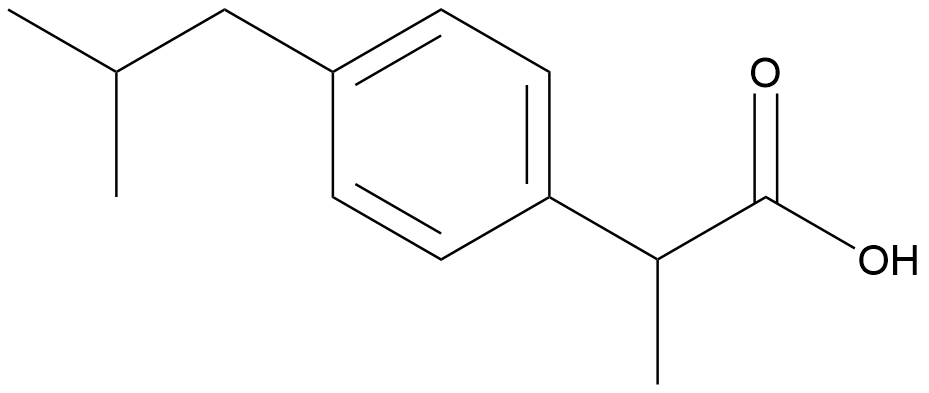
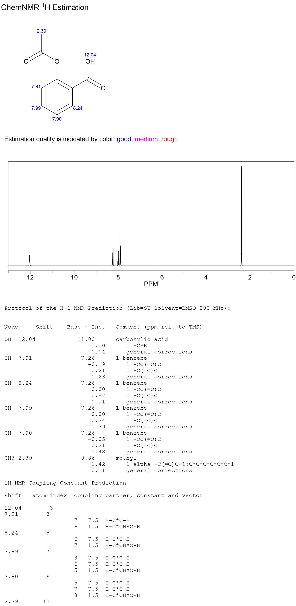

# ChemDraw Toolkit for DeepSeek Harness

Seven `chem_*` tools that let a DSH agent work with **ChemDraw on Windows**: draw and
beautify structures, predict 1H/13C NMR, convert between chemical file formats, read a
structure out of a picture, and hand a file to the interactive ChemDraw window.

The plugin is host-only: it registers agent tools and adds no browser UI. It drives the
ChemDraw installation that is already on the machine, through ChemDraw's own COM
automation server and its bundled ChemScript engine — nothing is re-implemented and no
chemistry model is downloaded.

| Tool | What it does |
| --- | --- |
| `chem_analyze` | Formula, molecular weight, exact mass, IUPAC name, SMILES, InChI, cLogP, TPSA, H-bond donors/acceptors, rotatable bonds, ring count. |
| `chem_draw` | Draw a structure from SMILES / InChI / name / `.cdx` / `.cdxml` / `.mol` / `.sdf` and save a tightly cropped PNG or SVG, plus optional `.cdx` / `.cdxml` / `.mol`. Bond length, line width, label size/font and caption size can be overridden. |
| `chem_beautify` | Run ChemDraw's clean-up on an existing structure (tidy 2D layout, normalised bond lengths), apply the same style settings and re-export PNG / SVG / `.cdx` / `.cdxml`. |
| `chem_nmr` | Predict a 1H or 13C spectrum with ChemNMR: per-atom shifts, the `Base + Inc.` protocol text, 1H coupling constants, and a rendered spectrum page with the shift-assignment table. |
| `chem_convert` | Convert between `cdx`, `cdxml`, `mol`, `sdf`, `smiles`, `inchi`, `svg`, `png`. |
| `chem_image_to_structure` | Recognise a drawn structure in a PNG/JPEG/BMP/GIF through the CACTUS OSRA web service, then validate and redraw it with ChemDraw. `neutralize` adds back a missing acidic proton when the OCR result comes out anionic. |
| `chem_open` | Open a structure file in the interactive ChemDraw window so the user can keep editing it by hand. |




## Requirements

- **Windows x64** — the plugin talks to ChemDraw over COM (`ChemDraw_x64.Application`) and
  to ChemScript through a native Python extension, so it does not run on macOS or Linux.
- **Revvity ChemDraw Suite 23.x installed** (ChemDraw + ChemScript). ChemDraw 23.1.1 was
  the version used for development; older versions that still expose ChemNMR and the COM
  automation server should work but are untested.
- **Python 3.10** — `ChemScript\Lib` ships `_ChemScriptForPy310.pyd` (and a 3.9 build).
  The DSH-bundled Python is 3.12 and cannot import it, so a separate 3.10 interpreter is
  needed; set `pythonPath` if it is not at the default location.
- **Network access** for `chem_image_to_structure` only (the OCR request goes to
  `cactus.nci.nih.gov`). Every other tool is offline. Set `allowNetwork: false` to refuse it.

## Install

From npm:

```sh
dsh plugin --profile <your-profile> add dsh-chemdraw-toolkit
```

From GitHub source:

```sh
dsh plugin --profile <your-profile> add github:OWNER/dsh-chemdraw-toolkit
```

Then restart DSH (or toggle the plugin off/on in **Settings → Plugins**). The seven tools
appear in the agent's tool list immediately after the plugin is enabled.

Default paths, all overridable through the plugin config:

| Key | Default |
| --- | --- |
| `pythonPath` | `C:\Users\<you>\AppData\Local\Programs\Python\Python310\python.exe` |
| `chemscriptLib` | `D:\CD\ChemScript\Lib` |
| `outputDir` | `%USERPROFILE%\Documents\DSH-ChemDraw` |
| `allowNetwork` | `true` |
| `timeoutMs` | `240000` |

## Usage

```text
chem_draw ibuprofen                       -> ibuprofen.png (575x472) + ibuprofen.cdxml
chem_beautify ./messy.cdx                 -> tidy PNG + CDXML
chem_nmr aspirin nucleus=13C              -> 9 shifts, protocol text, spectrum PNG
chem_image_to_structure screenshot.png    -> SMILES + formula + IUPAC name + redrawn PNG
chem_convert structure.cdx formats=sdf,smiles
```

Outputs land in `outputDir` (or the `out_dir` argument) and the tool result carries the
file paths, so the agent can attach the image to an answer or pass the file to another
tool.

## How it works

- `index.js` registers the tools and shells out to two backends:
  `backend/chem.py` (Python 3.10 + ChemScript) for parsing, properties, names and
  format conversion, and `backend/chemdraw.ps1` (Windows PowerShell + COM) for anything
  that needs a rendering engine: draw, clean, NMR, open.
- ChemNMR is driven by executing ChemDraw's own menu command (1H: 370, 13C: 371). It
  opens a new document with the predicted spectrum, the annotated structure and a
  protocol document; the shift and coupling tables are parsed out of that document's
  caption text, which is where ChemNMR writes them.
- Every ChemDraw instance the plugin starts is closed again afterwards. Only an instance
  the plugin did not start is left alone, and `chem_open` deliberately keeps its window.

## Known limitations

- ChemNMR needs a **visible** ChemDraw window; the prediction command fails silently when
  the automation server is hidden. Rendering and clean-up work hidden.
- OSRA is weakest on delocalised/dashed aromatic rings; `chem_draw` input and screenshots
  of real ChemDraw drawings usually work, small or hand-drawn ones may not. The tool
  enlarges inputs under 900 px first.
- OSRA frequently drops the acidic proton of a carboxylic acid; `neutralize` (default
  `true`) fixes that, at the cost of also "fixing" a genuine carboxylate salt — pass
  `neutralize: false` for real salts.
- Structure-to-name and name-to-structure quality is ChemScript's, not the plugin's.

## 中文说明

这个插件把本机已安装的 **ChemDraw 23** 变成 DSH 智能体的能力：画结构、批量美化、
用 ChemNMR 预测 1H/13C 核磁、在 cdx/cdxml/mol/sdf/smiles/inchi/svg 之间互转、从图片里
识别结构并重绘，另外可以把文件直接在 ChemDraw 窗口里打开继续编辑。

需要 Windows x64、已安装 ChemDraw Suite 23.x（带 ChemScript）、Python 3.10；只有
「图片转结构」需要联网（CACTUS OSRA）。安装后重启 DSH，或在「设置 → 插件」里关掉再打开发挥作用。

实现上，Node 侧只负责工具注册与调度：化学解析、属性、命名走 ChemScript（Python），
绘制/清理/预测走 ChemDraw COM（PowerShell）。核磁位移是从 ChemNMR 生成的协议文档
caption 文本里解析出来的，不是从文件格式读取的。

## License

MIT — see [LICENSE](LICENSE).
